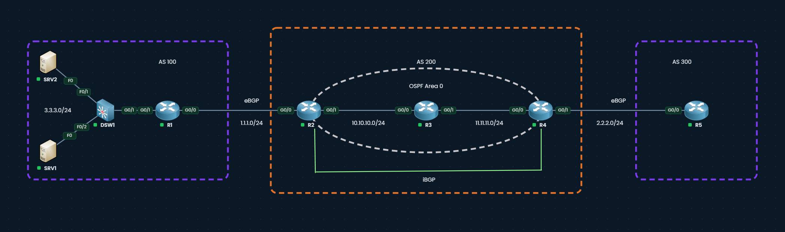

# BGP Transit Black Hole

Shows how a non-BGP router inside a transit AS black-holes traffic, and how a full iBGP mesh fixes it.

**CCNP ENARSI (300-410):** 1.10 Troubleshoot BGP

## Topology



| Device | Interface | IP | Role |
|--------|-----------|----|------|
| R1 (AS 100) | G0/0 / G0/1 | 1.1.1.1 / 3.3.3.1 | Originates 3.3.3.0/24 |
| R2 (AS 200) | G0/0 / G0/1 | 1.1.1.2 / 10.10.10.2 | Edge, eBGP + iBGP |
| R3 (AS 200) | G0/0 / G0/1 | 10.10.10.3 / 11.11.11.3 | Transit, OSPF only |
| R4 (AS 200) | G0/0 / G0/1 | 11.11.11.4 / 2.2.2.4 | Edge, eBGP + iBGP |
| R5 (AS 300) | G0/0 | 2.2.2.5 | Receiver |
| SRV1 / SRV2 | Fa0 | 3.3.3.3 / 3.3.3.2 | Hosts behind DSW1 (L2) |

OSPF area 0 runs on R2, R3, R4 (10.10.10.0/24 and 11.11.11.0/24 only). Full configs: [configs.md](configs.md).

## Run it

Build the topology in the PingMyNetwork sandbox and apply [configs.md](configs.md).

1. **Check BGP.** R5: `show ip bgp` lists 3.3.3.0/24 via AS path `200 100`.
2. **Find the gap.** R3: `show ip route 3.3.3.0` returns "not in table".
3. **See the black hole.** R5: `traceroute 3.3.3.3 source 2.2.2.5` shows 2.2.2.4 (R4), then `* * *` because R3 drops the packet.
4. **Fix it.** Make R3 an iBGP peer of R2 and R4, and let R5 advertise its subnet for the return path:
   ```
   R3: router bgp 200
        neighbor 10.10.10.2 remote-as 200
        neighbor 11.11.11.4 remote-as 200
   R2: router bgp 200
        neighbor 10.10.10.3 remote-as 200
        neighbor 10.10.10.3 next-hop-self
   R4: router bgp 200
        neighbor 11.11.11.3 remote-as 200
        neighbor 11.11.11.3 next-hop-self
   R5: router bgp 300
        network 2.2.2.0 mask 255.255.255.0
   ```
5. **Verify.** R3: `show ip route 3.3.3.0` shows a `B` route. R5: traceroute reaches 3.3.3.3.

## Takeaway

The old **iBGP synchronization rule** stopped R4 from advertising a route the IGP didn't know, preventing this exact black hole. Modern IOS removed the `synchronization` command, so the fix is to run BGP on every transit router (full mesh or route reflectors).
